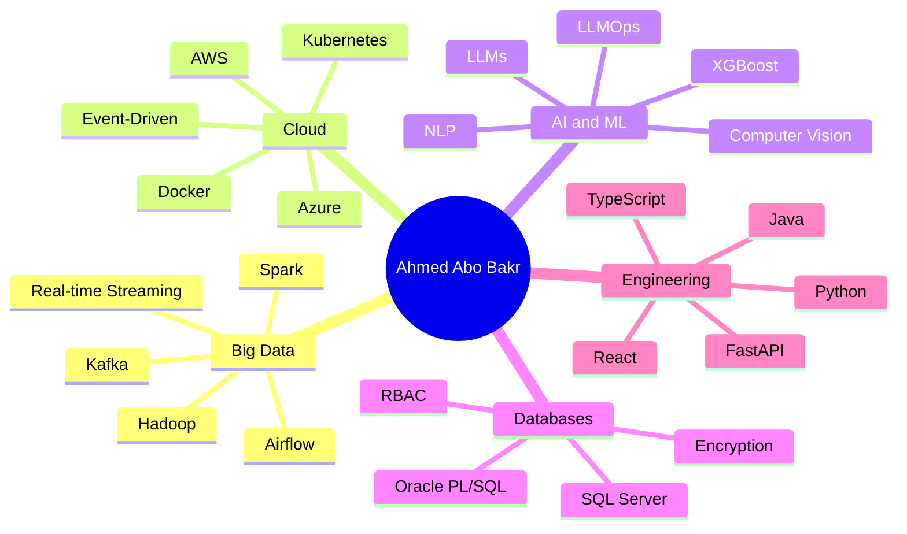
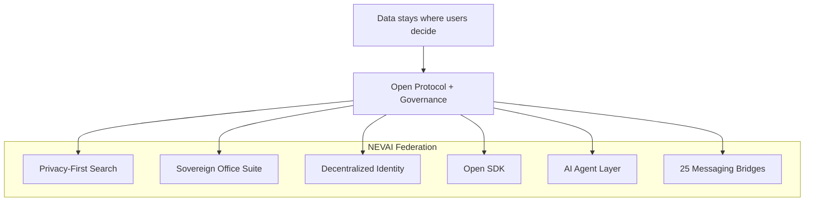

# Ahmed Abo Bakr

### Big Data Engineer

**ETL/ELT · Data Warehousing · Real-time Streaming · Spark · Airflow · SQL · Cloud (AWS / Azure)**

Architecting scalable, high-performance, cost-optimized data ecosystems.

Cairo, Egypt

 

[**Portfolio**](https://ahmed-abo-bakr.pages.dev/) &nbsp;·&nbsp; [**Home**](https://ahmed-abo-bakr.pages.dev/) &nbsp;·&nbsp; [**Blog**](https://ahmed-abo-bakr.pages.dev/blog) &nbsp;·&nbsp; [**Projects**](https://ahmed-abo-bakr.pages.dev/projects) &nbsp;·&nbsp; [**Resume**](https://ahmed-abo-bakr.pages.dev/resume) &nbsp;·&nbsp; [**Contact**](https://ahmed-abo-bakr.pages.dev/contact)

 

 

| 26 | 10 | 410 | 6 |
|:---:|:---:|:---:|:---:|
| **Certifications** | **Projects** | **Contributions** | **Skill Areas** |

---

## About Me

Big Data Engineer passionate about architecting scalable, high-performance data solutions. Proven expertise in building end-to-end data platforms, real-time streaming pipelines, and enterprise data warehouses using **Spark, Airflow, Python, and Cloud (AWS/Azure)**.

Track record of:

- Leading international teams across **Egypt, Germany and Russia**
- Designing secure data environments with RBAC, AES-256 encryption and inference control
- Delivering systems that power data-driven insights
- **Top Performer — AI & ML Track, Route Academy**
- **73 certifications across 8 domains** including Oxford, Google, AWS, UN, IBM and Huawei

[Email](mailto:Ahmedbakr@internet.ru) &nbsp;·&nbsp; [LinkedIn](https://linkedin.com/in/ahmed-abo-bakr) &nbsp;·&nbsp; [GitHub](https://github.com/Ahmedbakr78) &nbsp;·&nbsp; [Portfolio](https://ahmed-abo-bakr.pages.dev/)

---

## What I Do

| Discipline | Description | Core Stack |
|---|---|---|
| **Big Data Engineering** | Design and implement scalable data pipelines, real-time streaming solutions and enterprise data warehouses | Spark · Airflow · Kafka · ETL/ELT · Data Warehousing |
| **Cloud Architecture** | Build secure, scalable cloud infrastructure with containerization, microservices and event-driven architectures | AWS · Azure · Docker · Kubernetes · Terraform |
| **AI & Machine Learning** | Develop intelligent systems using NLP, LLMs, computer vision and predictive modeling | NLP · LLMs · LLMOps · XGBoost · Hugging Face |
| **Database Solutions** | Design and optimize relational and NoSQL databases with advanced security, RBAC, encryption and performance tuning | SQL Server · Oracle PL/SQL · Database Security · RBAC |
| **Full-Stack Development** | Build modern web applications with seamless frontend-backend integration | React · Python · Java · TypeScript · FastAPI · Spring Boot |
| **Data Analytics & Visualization** | Transform raw data into actionable insights through statistical analysis, EDA and interactive dashboards | Statistical Modeling · EDA · Regression · Visualization |

---

## Featured Projects

| Project | Description | Stack |
|---|---|---|
| [**Production-Grade Big Data Pipeline**](https://github.com/Ahmedbakr78/engineer-a-production-grade-end-to-end-Big-Data-pipeline-that-demonstrates-advanced-proficiency) | End-to-end big data processing pipeline with distributed computing, fault tolerance, data quality checks and production monitoring | Shell · Spark · ETL |
| [**MIZAN — Egyptian Arabic Legal Assistant**](https://ahmed-abo-bakr.pages.dev/projects) | NLP system for Egyptian Arabic legal documents using Retrieval-Augmented Generation (RAG) with a Gradio interface | Python · NLP · RAG · AI |
| [**Focus Search Engine**](https://github.com/Ahmedbakr78/5-A-Nevai-Search-Engine) | Privacy-focused AI-powered search engine with a Chrome extension, REST API and advanced ranking algorithms | Python · JavaScript · REST · Chrome |
| [**Spotify Trends Visualization**](https://github.com/Ahmedbakr78/data-visualization-SpotifyTrends) | Data engineering for music streaming analytics: Spotify API, ETL pipeline, warehousing and interactive dashboards | Python · ETL · Visualization |
| [**GitHub Repository Mining**](https://github.com/Ahmedbakr78/GitHub-Repository-Mining--Advanced-Data-Mining-Project) | Automated data-mining pipeline extracting insights from repositories with parallel processing at scale | Python · Data Mining · Analytics |
| [**Student Management System**](https://github.com/Ahmedbakr78) | AI-powered academic platform with FastAPI backend, React frontend and predictive analytics | Python · FastAPI · React · AI |
| [**Blockchain Voting System**](https://github.com/Ahmedbakr78) | Decentralized voting with cryptographic anonymity and smart-contract-based tallying | Python · Blockchain · Security |
| [**Automated X-Ray Fracture Reporting**](https://github.com/Ahmedbakr78) | Computer-vision system detecting and classifying bone fractures from X-ray images with automated reporting | Python · Computer Vision · Healthcare |
| [**Movie Analytics Dashboard**](https://github.com/Ahmedbakr78) | Film-industry analytics with EDA, trend visualization, statistical modeling and box-office prediction | Python · Jupyter · Statistics |
| [**University Exam Management System**](https://github.com/Ahmedbakr78) | Enterprise Oracle database solution for exam scheduling, enrollment, grading and reporting | Oracle PL/SQL · Database |

[View all projects on the portfolio](https://ahmed-abo-bakr.pages.dev/projects) &nbsp;·&nbsp; [View all repositories on GitHub](https://github.com/Ahmedbakr78?tab=repositories)

---

## Open-Source Work — The Nevai Ecosystem

Founder and builder of **NEVAI**, a decentralized, federated workspace platform built from the ground up with its own open protocol, identity layer and governance system. The ecosystem ships a 25-bridge messaging federation over Matrix, an encrypted office suite, a no-code database, AI agent tooling and a privacy-first browser suite.

| Area | What was built |
|---|---|
| **Privacy-first search** | AI-powered search engine that runs entirely in the browser — no data leaves the device |
| **Sovereign office suite** | 100% self-hosted productivity tools — docs, sheets, slides, forms, kanban, code, whiteboards |
| **Federated architecture** | Data lives where users decide — no single central authority |
| **Decentralized identity** | One identity across the whole federation, no central authority |
| **Open SDK** | Build on top of NEVAI instead of being locked inside it |
| **AI agent layer** | Intelligence built directly into the protocol |
| **Messaging federation** | 25 platform bridges (Matrix C-S API, media and formatting relay, presence and read-state sync) |

### Browser Suite

Six Chromium (MV3) extensions, one design language: free, private, unlimited, 100% local.

| Project | Description |
|---|---|
| [**Heros PDF**](https://github.com/Ahmedbakr78/Heros_PDF) | PDF viewer and editor studio — annotate, merge, split, search, watermark |
| [**Heros Markdown**](https://github.com/Ahmedbakr78/heros-markdown) | Markdown studio — offline KaTeX math, every Mermaid diagram, RTL support |
| [**Heros NoteBook**](https://github.com/Ahmedbakr78/Heros_Jupter) | `.ipynb` viewer with a real Python runner via Pyodide WebAssembly |
| [**Heros Todo**](https://github.com/Ahmedbakr78/Heros_Todo) | Markdown, PDF and LaTeX panel studio with workspaces and clickable tasks |
| [**Heros Player**](https://github.com/Ahmedbakr78/Heros_Music_Player) | Remote control for YouTube Music, YouTube and Spotify tabs |
| [**markClipper**](https://github.com/Ahmedbakr78/Heros_Note) | Web clipper and Photo Lab — articles, selections and galleries to Markdown |

---

## Technical Expertise

<table>
<tr>
<td valign="top" width="50%">

### Big Data & Engineering

`Apache Spark` `Airflow` `Kafka` `Hadoop` `ETL/ELT` `Real-time Streaming` `Data Warehousing`

### Cloud & Infrastructure

`AWS` `Azure` `Docker` `Kubernetes` `EKS/ECS` `Event-Driven Architecture` `Terraform`

### Databases & SQL

`SQL Server` `T-SQL` `Oracle PL/SQL` `RBAC` `Database Security` `AES-256`

</td>
<td valign="top" width="50%">

### AI & Machine Learning

`NLP` `LLMs` `LLMOps` `XGBoost` `Computer Vision` `Hugging Face` `Predictive Modeling`

### Languages & Frameworks

`Python` `Java` `JavaScript/TS` `C#` `Spring Boot` `React` `FastAPI` `SQL`

### Data & Analytics

`Data Mining` `EDA` `Regression` `Association Rules` `Statistical Modeling` `PCA`

</td>
</tr>
</table>

---

## Experience

### Executive Chairman & Founder — Independent

**Jan 2026 – Present**

A decentralized, federated workspace platform built from the ground up with its own open protocol, identity layer and governance system.

- Built a privacy-first, AI-powered search engine running entirely in the browser with no data leaving the device
- Developed a sovereign office suite offering 100% self-hosted productivity tools
- Implemented federated architecture — data lives where users decide
- Created decentralized identity — one identity, no central authority
- Designed an open SDK — build on top of NEVAI, not locked inside it
- Integrated an AI agent layer — intelligence built into the protocol
- Delivered a full business workspace — docs, communication, tasks, search, all native

### Security Lead — Secure Student Records Management System

**Jan 2025 – Mar 2025** — Multi-layered database security system

- Developed a multi-layered database security system integrating 5 security models
- Established Role-Based Access Control reducing unauthorized access attempts by 95%
- Enforced multilevel security models preventing unauthorized data access
- Integrated AES-256 encryption for sensitive data protection
- Programmed inference control mechanisms to thwart statistical attacks

### Project Lead Developer — Five-A Analytics

**Oct 2024 – Dec 2024** — Automated machine learning platform

- Architected an automated ML platform processing 50,000+ data rows
- Configured 8 regression algorithms achieving 92% R-squared accuracy
- Pioneered an AI-powered natural language query module for quick analytics
- Constructed interactive data visualization dashboards generating 12 chart types
- Streamlined statistical hypothesis testing across 30 variable combinations
- Orchestrated a 6-stage data pipeline reducing processing time to under 2 minutes

---

## Education

### Helwan National University

**Computer Science** — GPA 3.0

Comprehensive computer science education covering data structures, algorithms, database systems, software engineering, artificial intelligence and distributed systems.

---

## Certifications

26 certifications from leading institutions — Microsoft, Google, IBM, University of Oxford, University of Sydney, University of Michigan, Duke University, AWS, UNICEF, Udacity and Saylor University.

| Certification | Issuer | Date |
|---|---|---|
| AI and Machine Learning Algorithms and Techniques | Microsoft | May 2026 |
| AI for App Building | Google | Apr 2026 |
| AI for Data Analysis | Google | Apr 2026 |
| AI for Research and Insights | Google | Apr 2026 |
| AI for Brainstorming and Planning | Google | Apr 2026 |
| AI Fundamentals | Google | Apr 2026 |
| Python for Data Science, AI & Development | IBM | Apr 2026 |
| Python Project for Data Engineering | IBM | Apr 2026 |
| AWS AI Practitioner Challenge | Udacity | Apr 2026 |
| Software Engineering | Saylor University | May 2026 |
| Blockchain Scalability and Distributed Systems | University of Sydney | Apr 2026 |
| Google AI | Google | 2026 |
| AI Ethics, Responsible Use, and Creativity | University of Michigan | Apr 2026 |
| Data Management and Analysis | UNICEF | Mar 2026 |
| AI and Digital Transformation in Government | University of Oxford | Mar 2026 |

*Additional certifications span MLOps (Duke University), Microsoft AI & ML Engineering, Azure for AI and Machine Learning, DevOps Essentials and more.*

---

## Achievements

- **Top Performer** — AI & ML Track, Route Academy
- **73 certifications** across 8 domains — Oxford, Google, AWS, UN, IBM, Huawei
- **34 GitHub projects** spanning Big Data, NLP, ML, Security and Full-Stack
- **Led international teams** across Egypt, Germany and Russia

---

## GitHub Activity

| Metric | Value |
|---|---|
| Contributions in the last year | 410 |
| Pull Requests | 93% |
| Code Review | 7% |

---

## Let's Work Together

Looking for expertise in **Big Data Engineering**, **Cloud Architecture** or **AI solutions**? Let's discuss how we can build something amazing together.

 

[**Home**](https://ahmed-abo-bakr.pages.dev/) &nbsp;·&nbsp; [**Blog**](https://ahmed-abo-bakr.pages.dev/blog) &nbsp;·&nbsp; [**Projects**](https://ahmed-abo-bakr.pages.dev/projects) &nbsp;·&nbsp; [**Resume**](https://ahmed-abo-bakr.pages.dev/resume) &nbsp;·&nbsp; [**Contact**](https://ahmed-abo-bakr.pages.dev/contact)

2026 Ahmed Abo Bakr. All rights reserved.

