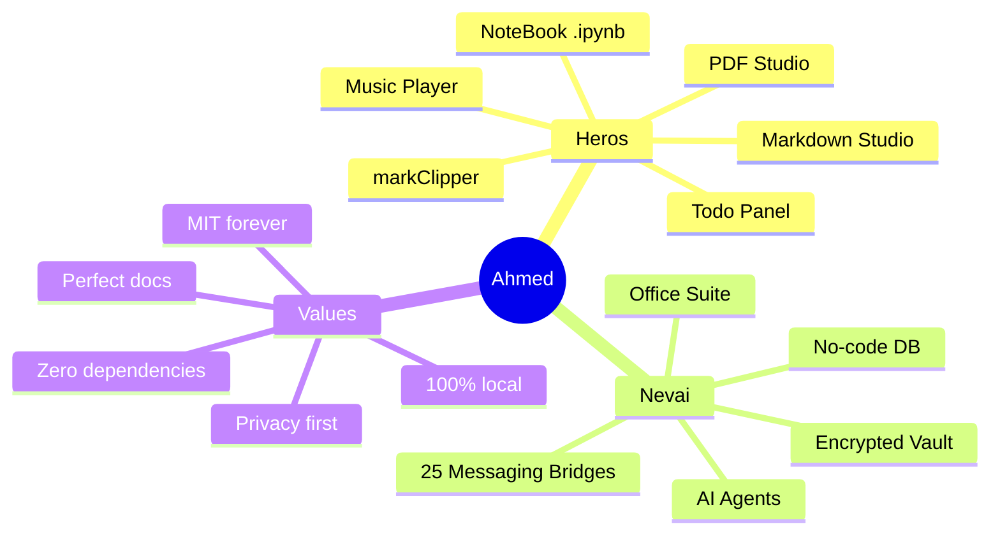
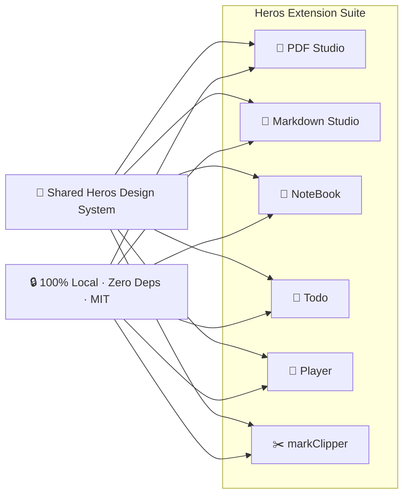
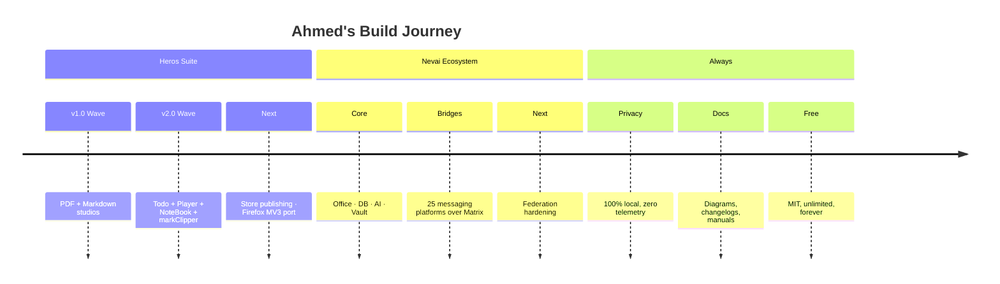

# Ahmed ABOBAKR

### Full-Stack Developer · Browser-Extension Craftsman · Privacy-First Builder

 

 

Building the **Heros** browser-extension suite and the **Nevai** private ecosystem.
Ships fast, documents deep, ships privacy-first. 100% local, free & unlimited — always.

---

## 🧭 About

I build software that stays on **your machine**. No clouds you don't control, no accounts you don't own, no telemetry you didn't ask for. My work spans two connected worlds:

- **Heros** — a family of Chromium (MV3) browser extensions that turn the sidebar into a studio: PDF, Markdown, Jupyter, Todo, Music remote, Web clipper. Every one is zero-dependency vanilla JS, 100% local, MIT, free forever.
- **Nevai** — a broader private ecosystem: encrypted office suite, no-code database, AI agent platform, collaborative tools, and a 25-bridge messaging federation over Matrix.

I care about **craft**: perfect Markdown, pixel-honest design systems, architecture diagrams everywhere, changelogs that actually explain *why*, and READMEs long enough to be a manual.

---

## 🏆 Featured — The Heros Suite

Six browser extensions, one design language, one promise: **free, private, unlimited.**

| | Project | What it does | |
|---|---|---|---|
| 📕 | [**Heros PDF**](https://github.com/Ahmedbakr78/Heros_PDF) | PDF viewer + editor studio — annotate, merge, split, search, watermark. pdf.js + pdf-lib + qpdf-wasm | [🌐](https://ahmedbakr78.github.io/Heros_PDF/) |
| 📗 | [**Heros Markdown**](https://github.com/Ahmedbakr78/heros-markdown) | Markdown studio — offline KaTeX math, every Mermaid diagram, RTL, 110 study tools | [🌐](https://ahmedbakr78.github.io/heros-markdown/) |
| 📘 | [**Heros NoteBook**](https://github.com/Ahmedbakr78/Heros_Jupter) | `.ipynb` viewer + **real Python runner** via Pyodide WASM. Builder studio, variable inspector | [🌐](https://ahmedbakr78.github.io/Heros_Jupter/) |
| 📙 | [**Heros Todo**](https://github.com/Ahmedbakr78/Heros_Todo) | Markdown + PDF + LaTeX panel studio — workspaces, real clickable tasks, flashcards, pomodoro | [🌐](https://ahmedbakr78.github.io/Heros_Todo/) |
| 🎵 | [**Heros Player**](https://github.com/Ahmedbakr78/Heros_Music_Player) | Full remote for YouTube Music / YouTube / Spotify tabs — seek, volume, queue, PiP | [🌐](https://ahmedbakr78.github.io/Heros_Music_Player/) |
| ✂️ | [**markClipper**](https://github.com/Ahmedbakr78/Heros_Note) | Web clipper + **Photo Lab** — articles, selections, 250-photo galleries → perfect Markdown | [🌐](https://ahmedbakr78.github.io/Heros_Note/) |

<b>Other public work (click to expand)</b>

| Project | What it is |
|---|---|
| [**TourMate**](https://github.com/Ahmedbakr78/Tour) | Full MEAN-stack smart tourism platform — Angular 17, Express, MongoDB, JWT auth, live tracking, Leaflet maps, i18n EN/AR + RTL |
| [**Web-to-Warehouse Pipeline**](https://github.com/Ahmedbakr78/Web-to-Warehouse-Product-Intelligence-Pipeline) | DEPI capstone: 35 sources → Kimball warehouse (Postgres/MySQL) → Airflow → FastAPI (216 endpoints) → React dashboard |

---

## 🛠️ Tech I Build With

---

## 📊 GitHub Analytics

 

<a href="https://gitstreak.com/profile/Ahmedbakr78" target="_blank">
  <picture>
    <source media="(prefers-color-scheme: dark)" srcset="https://github-readme-streak-stats.herokuapp.com/?user=Ahmedbakr78&theme=transparent&hide_border=true&background=00000000&stroke=4c8dff&ring=8A2BE2&fire=14b8a6&currStreakNum=b0b9c6&sideNums=b0b9c6&currStreakLabel=4c8dff&sideLabels=b0b9c6&dates=79839a">
    
  </picture>
</a>

  

---

## 🗺️ Roadmap

---

## 💬 Principles I Build By

- 🔒 **Privacy is the default** — if data can leave the machine, it must be an explicit, visible choice.
- 📦 **Zero dependencies when possible** — what you load is what runs; auditable, fast, unbreakable by a supply chain.
- 📖 **Docs are a feature** — architecture diagrams, sequence flows, 30-question FAQs, full changelogs.
- 🎨 **Design is not decoration** — a unified design system across the whole suite.
- ♾️ **Free & unlimited forever** — MIT, no quotas, no accounts, no upsells.

---

### Thanks for visiting — let's build something private and fast.

MIT licensed · 100% local · free forever · built by Ahmed ABOBAKR

