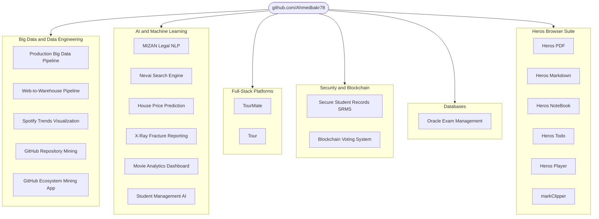
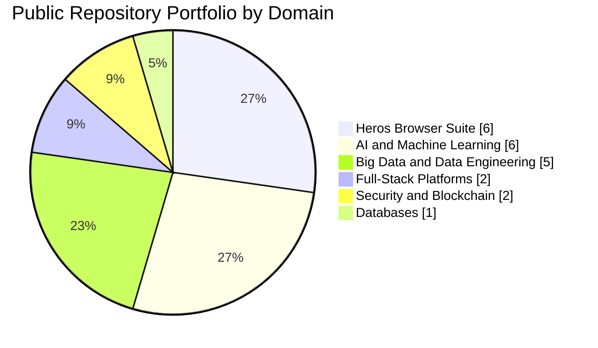
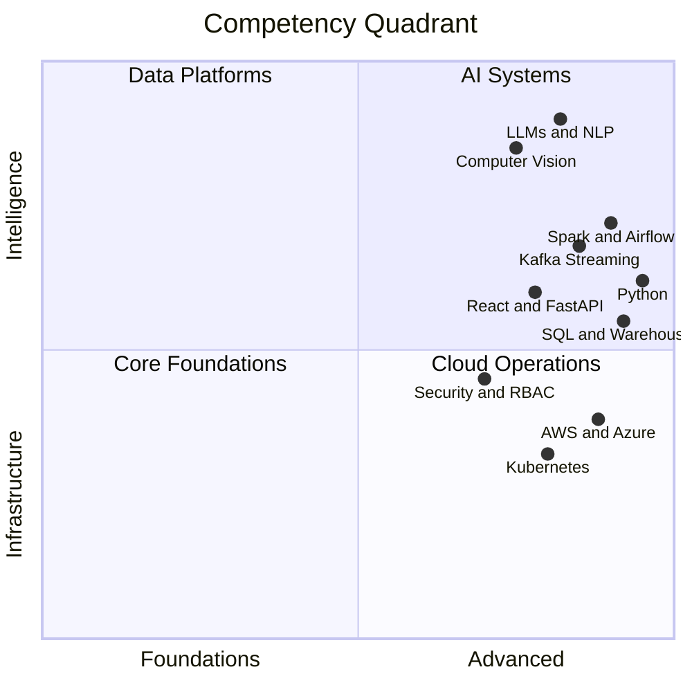
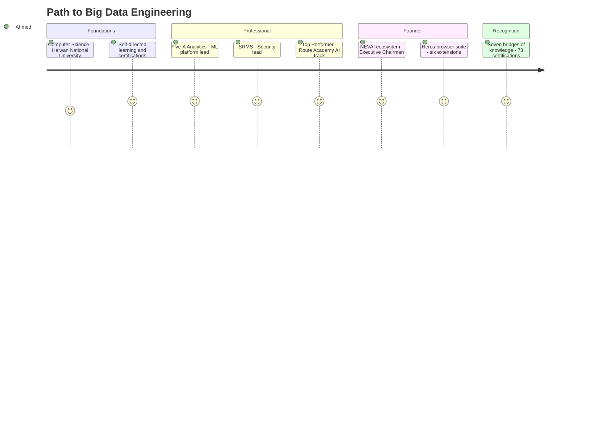
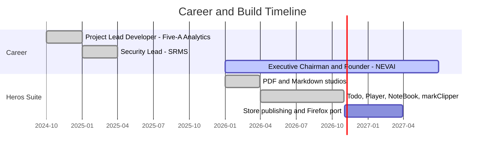
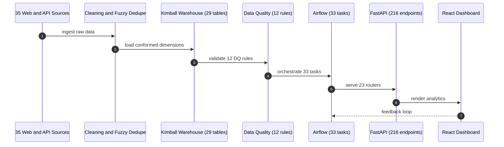
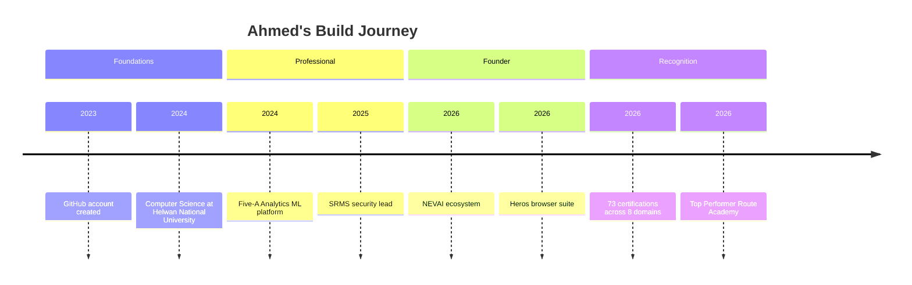
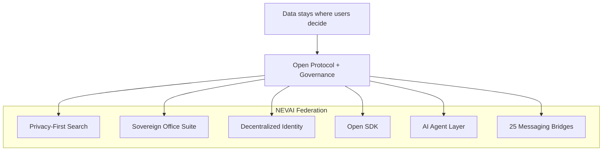

**ETL/ELT · Data Warehousing · Real-time Streaming · Spark · Airflow · SQL · Cloud (AWS / Azure)**

Architecting scalable, high-performance, cost-optimized data ecosystems.

Cairo, Egypt · [Ahmedbakr@internet.ru](mailto:Ahmedbakr@internet.ru)

 

[**Portfolio**](https://ahmed-abo-bakr.pages.dev/) &nbsp;·&nbsp; [**Blog**](https://ahmed-abo-bakr.pages.dev/blog) &nbsp;·&nbsp; [**Projects**](https://ahmed-abo-bakr.pages.dev/projects) &nbsp;·&nbsp; [**Resume**](https://ahmed-abo-bakr.pages.dev/resume) &nbsp;·&nbsp; [**Contact**](https://ahmed-abo-bakr.pages.dev/contact)

 

 

| 26 | 73 | 22 | 410 | 8 | 25 |
|:---:|:---:|:---:|:---:|:---:|:---:|
| **Certifications** | **Across 8 Domains** | **Public Repositories** | **Contributions** | **Skill Areas** | **Matrix Bridges** |

---

## About Me

Big Data Engineer passionate about architecting scalable, high-performance data solutions. Proven expertise in building end-to-end data platforms, real-time streaming pipelines and enterprise data warehouses using **Spark, Airflow, Python and Cloud (AWS/Azure)**.

Track record of:

- Leading international teams across **Egypt, Germany and Russia**
- Designing secure data environments with RBAC, AES-256 encryption and inference control
- Delivering systems that power data-driven insights
- **Top Performer — AI & ML Track, Route Academy**
- **73 certifications across 8 domains** including Oxford, Google, AWS, UN, IBM and Huawei

[Email](mailto:Ahmedbakr@internet.ru) &nbsp;·&nbsp; [LinkedIn](https://linkedin.com/in/ahmed-abo-bakr) &nbsp;·&nbsp; [GitHub](https://github.com/Ahmedbakr78) &nbsp;·&nbsp; [Portfolio](https://ahmed-abo-bakr.pages.dev/)

---

## Tech Arsenal

### Big Data and Engineering

### Cloud and Infrastructure

### Databases and SQL

### AI and Machine Learning

### Languages and Frameworks

### Security and Systems

---

## What I Do

| Discipline | Description | Core Stack |
|---|---|---|
| **Big Data Engineering** | Design and implement scalable data pipelines, real-time streaming solutions and enterprise data warehouses | Spark · Airflow · Kafka · ETL/ELT · Data Warehousing |
| **Cloud Architecture** | Build secure, scalable cloud infrastructure with containerization, microservices and event-driven architectures | AWS · Azure · Docker · Kubernetes · Terraform |
| **AI & Machine Learning** | Develop intelligent systems using NLP, LLMs, computer vision and predictive modeling | NLP · LLMs · LLMOps · XGBoost · Hugging Face |
| **Database Solutions** | Design and optimize relational and NoSQL databases with advanced security, RBAC, encryption and performance tuning | SQL Server · Oracle PL/SQL · Database Security · RBAC |
| **Full-Stack Development** | Build modern web applications with seamless frontend-backend integration | React · Python · Java · TypeScript · FastAPI · Spring Boot |
| **Data Analytics & Visualization** | Transform raw data into actionable insights through statistical analysis, EDA and interactive dashboards | Statistical Modeling · EDA · Regression · Visualization |

---

## Repository Portfolio Map

### Portfolio Distribution by Domain

### Skill Focus Map

### Career Journey

### Experience Timeline

### Data Pipeline Flow — Web-to-Warehouse

### Build Journey

---

## Big Data and Data Engineering

| Repository | Description | Tech | Activity |
|---|---|---|---|
| [**Production-Grade End-to-End Big Data Pipeline**](https://github.com/Ahmedbakr78/engineer-a-production-grade-end-to-end-Big-Data-pipeline-that-demonstrates-advanced-proficiency) | Distributed computing, fault tolerance, automated validation, data quality checks and production monitoring across the full pipeline lifecycle |   | 1 star · 1 fork |
| [**Web-to-Warehouse Product Intelligence Pipeline**](https://github.com/Ahmedbakr78/Web-to-Warehouse-Product-Intelligence-Pipeline) | DEPI capstone: 35 permitted web/API sources → cleaning → fuzzy dedupe → 29-table Kimball warehouse → Airflow (33 tasks) → FastAPI (23 routers, 216 endpoints) → React 19 dashboard |    | Active |
| [**Spotify Trends Visualization**](https://github.com/Ahmedbakr78/data-visualization-SpotifyTrends) | Unified full-stack ecosystem for streaming analytics: API orchestration, ETL pipeline, data warehousing, interactive dashboards and AI integration |   | 1 star · 1 fork |
| [**GitHub Repository Mining — Advanced Data Mining**](https://github.com/Ahmedbakr78/GitHub-Repository-Mining--Advanced-Data-Mining-Project) | Reproducible multi-stage data mining and NLP pipeline: repository data collection, preprocessing, feature engineering and association analysis |  | Active |
| [**GitHub Ecosystem Mining App**](https://github.com/Ahmedbakr78/GitHub-ecosystem-mining-app) | Web mining and repository data collection with data preprocessing, feature engineering and association rules |  | Active |

---

## AI and Machine Learning

| Repository | Description | Tech | Activity |
|---|---|---|---|
| [**MIZAN — Egyptian Arabic Legal Assistant**](https://ahmed-abo-bakr.pages.dev/projects) | NLP system for Egyptian Arabic legal documents with Retrieval-Augmented Generation, Gradio interface and complex legal terminology handling |    | Featured |
| [**5-A Nevai Search Engine**](https://github.com/Ahmedbakr78/5-A-Nevai-Search-Engine) | Privacy-focused AI-powered multi-source search engine (SPA) with enterprise-grade security, Chrome extension and RESTful API |   | 1 fork |
| [**House Price Prediction and Customer Segmentation**](https://github.com/Ahmedbakr78/House-Price-Prediction-Customer-Segmentation) | Dual ML workflows: regression with advanced preprocessing and state-of-the-art algorithms, plus customer segmentation |   | 1 star · 1 fork |
| [**Automated Multi-Modal X-Ray Fracture and Crack Reporting**](https://github.com/Ahmedbakr78/Automated-Multi-Modal-X-Ray-Fracture-Crack-Reporting-System) | Computer-vision medical system: detects and classifies bone fractures from X-ray images with automated reporting |    | 1 star · 1 fork |
| [**MR — Movie Analytics Dashboard (Cinematics)**](https://github.com/Ahmedbakr78/MR---Movie-Analytics-Dashboard-Cinematics-Dashboard-) | Web-based film-industry analytics platform: EDA, trend visualization, statistical modeling and box-office prediction |   | 1 star · 1 fork |
| [**5-A Student Management System**](https://github.com/Ahmedbakr78/5-A-Student-Management-System) | AI-powered student management and search platform using FastAPI and React with predictive analytics |   | Active |
| [**Student Management System — Modular Architecture**](https://github.com/Ahmedbakr78/Student-Management-System-was-engineered-with-distinct) | Engineered with distinct, measurable objectives to overcome common limitations in monolithic educational software |  | Active |

---

## Full-Stack Platforms

| Repository | Description | Tech | Activity |
|---|---|---|---|
| [**TourMate**](https://github.com/Ahmedbakr78/TourMate) | Full MEAN-stack smart tourism platform (Tourist, Driver, Guide, Admin): Angular 17 standalone, Express + MongoDB, JWT/bcrypt auth, polling-based live tracking, Overpass/OSRM integration, Leaflet maps, i18n EN/AR + RTL, Zara/Zen monochrome UI, Swagger docs, Docker and CI ready |    | Active |
| [**Tour**](https://github.com/Ahmedbakr78/Tour) | Smart tourism platform — live tracking, real-time maps, multi-role dashboards and bilingual interface |  | 1 star · 1 fork |

---

## Security and Blockchain

| Repository | Description | Tech | Activity |
|---|---|---|---|
| [**Secure Student Records Management System (SRMS)**](https://github.com/Ahmedbakr78/Data-Security-Secure-Student-Records-Management-System-SRMS-) | Database application enforcing five core database security models: RBAC, multilevel security, AES-256 encryption and inference control |   | 1 star · 1 fork |
| [**Blockchain-Powered Voting System**](https://github.com/Ahmedbakr78/secure-blockchain-powered-voting-system-featuring-a-graphical-interface-background-data-auditing) | Decentralized voting with graphical interface, cryptographic security for voter anonymity and background data auditing |   | Active |

---

## Databases

| Repository | Description | Tech | Activity |
|---|---|---|---|
| [**University Exam Management System (Oracle)**](https://github.com/Ahmedbakr78/University-Exam-Management-System-Oracle) | Multi-user Oracle PL/SQL solution with strict separation of duties, robust business logic, exam scheduling, enrollment, grading and reporting |  | 1 star · 1 fork |

---

## Nevai Ecosystem — Founder and Builder

NEVAI is a decentralized, federated workspace platform built from the ground up with its own open protocol, identity layer and governance system. The ecosystem ships a 25-bridge messaging federation over Matrix, an encrypted office suite, a no-code database, AI agent tooling and a privacy-first browser suite.

| Area | What was built |
|---|---|
| **Privacy-first search** | AI-powered search engine that runs entirely in the browser — no data leaves the device |
| **Sovereign office suite** | 100% self-hosted productivity tools — docs, sheets, slides, forms, kanban, code, whiteboards |
| **Federated architecture** | Data lives where users decide — no single central authority |
| **Decentralized identity** | One identity across the whole federation, no central authority |
| **Open SDK** | Build on top of NEVAI instead of being locked inside it |
| **AI agent layer** | Intelligence built directly into the protocol |
| **Messaging federation** | 25 platform bridges (Matrix C-S API, media and formatting relay, presence and read-state sync) |

### Heros Browser Suite

Six Chromium (MV3) extensions, one design language: free, private, unlimited, 100% local.

| Repository | Description | Website |
|---|---|---|
| [**Heros PDF**](https://github.com/Ahmedbakr78/Heros_PDF) | PDF viewer and editor studio — annotate, merge, split, search, watermark | [Site](https://ahmedbakr78.github.io/Heros_PDF/) |
| [**Heros Markdown**](https://github.com/Ahmedbakr78/heros-markdown) | Markdown studio — offline KaTeX math, every Mermaid diagram, RTL support | [Site](https://ahmedbakr78.github.io/heros-markdown/) |
| [**Heros NoteBook**](https://github.com/Ahmedbakr78/Heros_Jupter) | `.ipynb` viewer with a real Python runner via Pyodide WebAssembly | [Site](https://ahmedbakr78.github.io/Heros_Jupter/) |
| [**Heros Todo**](https://github.com/Ahmedbakr78/Heros_Todo) | Markdown, PDF and LaTeX panel studio with workspaces and clickable tasks | [Site](https://ahmedbakr78.github.io/Heros_Todo/) |
| [**Heros Player**](https://github.com/Ahmedbakr78/Heros_Music_Player) | Remote control for YouTube Music, YouTube and Spotify tabs | [Site](https://ahmedbakr78.github.io/Heros_Music_Player/) |
| [**markClipper**](https://github.com/Ahmedbakr78/Heros_Note) | Web clipper and Photo Lab — articles, selections and galleries to Markdown | [Site](https://ahmedbakr78.github.io/Heros_Note/) |

---

## Complete Skills Matrix

### Spotlight Skills

`Data Management` `Data Analysis` `Big Data` `Google Analytics`

<b>Big Data and Engineering</b>

 

`Apache Spark` `Apache Airflow` `Kafka` `Kafka Integration` `Hadoop` `ETL/ELT` `Real-time Streaming` `Data Warehousing` `Parallel Programming` `Designing Event-Driven Architectures` `Big Data Associate` `Troubleshooting`

<b>Cloud and Infrastructure</b>

 

`AWS` `Azure` `Microsoft Azure for AI and Machine Learning` `Docker` `Kubernetes` `Containers on Amazon EKS` `Amazon ECS` `Amazon Aurora MySQL` `Connecting Systems and Machines to AWS` `Practical Data Science with Amazon SageMaker` `Event-Driven Architecture` `Terraform`

<b>Databases and SQL</b>

 

`SQL Server` `T-SQL` `Oracle PL/SQL` `SQL` `H2 Integration` `RBAC` `Database Security` `AES-256 Encryption` `Multilevel Security` `Inference Control` `Data Integrity` `Query Optimization`

<b>AI and Machine Learning</b>

 

`Artificial Intelligence and Machine Learning` `AI` `Machine Learning` `Machine Learning Essentials for Business` `NLP` `LLMs` `LLMOps` `Hugging Face` `Statistical Models like BoW and TF-IDF` `Importance of Embeddings for NLP` `Embedding Metrics and Visualization` `Techniques for Static Embeddings` `Foundations of Prompt Engineering` `Managing the Application` `XGBoost` `Computer Vision` `Predictive Modeling` `Regression Analysis` `PCA` `Association Rules` `Automated Machine Learning`

<b>AI and ML for Healthcare</b>

 

`NLP for Clinical Data` `Predictive Modeling for Disease Progression` `Machine Learning for Healthcare Analytics` `Computer Vision for Motor Symptom Monitoring` `Healthcare Data Mining and Analytics` `Health Informatics Software Development` `Telehealth and Telemedicine Platforms`

<b>Languages and Frameworks</b>

 

`Python` `Java` `JavaScript` `TypeScript` `C#` `ASP.NET` `Spring Boot` `React` `FastAPI` `Node.js` `REST API Integration` `REST API Controller` `SQL` `Browser Extensions (MV3)`

<b>Data and Analytics</b>

 

`Data Mining` `EDA` `Exploratory Data Analysis` `Statistical Modeling` `Hypothesis Testing` `Production-Grade Big Data Pipelines` `Data Visualization` `Interactive Dashboards` `Business Models` `Research in Finance` `Account Management`

<b>Analytics, SEO and Digital Marketing</b>

 

`Google Analytics` `SEO` `Technical SEO Analyst` `Keyword Research` `Digital Marketing` `AI-Powered Performance Ads` `AI-Powered Shopping Ads` `Microsoft Office 365`

<b>Security and Systems</b>

 

`Information Security` `Information Technology` `Systems Engineering` `Computational Thinking` `5 Security Models` `Role-Based Access Control` `Statistical Attack Mitigation` `Blockchain Scalability and Distributed Systems` `Cryptographic Anonymity` `Smart Contracts`

<b>Sustainability and UN Programs</b>

 

`Climate Resilience Data Analyst` `Green Finance Data Analyst` `Sustainable IT Analyst` `E-Waste Data` `Green Industrial Policy` `Regulatory Compliance IT Analyst` `Social Impact Technologist` `Sustainable Development Data Analyst` `Digital Program Planning Analyst`

<b>Professional and Soft Skills</b>

 

`Strategic Communication and Teamwork` `Empathetic Communication` `Self-Directed Learning` `Design Thinking` `Creativity` `Teamwork` `Volunteering` `International Team Leadership` `Technical Writing`

---

## Experience

### Executive Chairman and Founder — Independent

**Jan 2026 – Present**

A decentralized, federated workspace platform built from the ground up with its own open protocol, identity layer and governance system.

- Built a privacy-first, AI-powered search engine running entirely in the browser with no data leaving the device
- Developed a sovereign office suite offering 100% self-hosted productivity tools
- Implemented federated architecture — data lives where users decide
- Created decentralized identity — one identity, no central authority
- Designed an open SDK — build on top of NEVAI, not locked inside it
- Integrated an AI agent layer — intelligence built into the protocol
- Delivered a full business workspace — docs, communication, tasks, search, all native

### Security Lead — Secure Student Records Management System

**Jan 2025 – Mar 2025** — Multi-layered database security system

- Developed a multi-layered database security system integrating 5 security models
- Established Role-Based Access Control reducing unauthorized access attempts by 95%
- Enforced multilevel security models preventing unauthorized data access
- Integrated AES-256 encryption for sensitive data protection
- Programmed inference control mechanisms to thwart statistical attacks

### Project Lead Developer — Five-A Analytics

**Oct 2024 – Dec 2024** — Automated machine learning platform

- Architected an automated ML platform processing 50,000+ data rows
- Configured 8 regression algorithms achieving 92% R-squared accuracy
- Pioneered an AI-powered natural language query module for quick analytics
- Constructed interactive data visualization dashboards generating 12 chart types
- Streamlined statistical hypothesis testing across 30 variable combinations
- Orchestrated a 6-stage data pipeline reducing processing time to under 2 minutes

### Training and Programs

| Program | Detail |
|---|---|
| Google Skillshop | Analytics and AI certifications |
| JPMorganChase Software Engineering Simulation | Spring, Kafka, REST (Forage) |
| Huawei Big Data Associate | National Telecommunication Institute (NTI) |
| NTI MEAN-Stack Training | 100% score |
| MCIT AI Advanced | Fast Lane in partnership with Microsoft |
| Route Academy — AI and ML Track | Top Performer |
| Oracle AI for You | Badge |

---

## Education

### Helwan National University

**Computer Science** — GPA 3.0

Comprehensive computer science education covering data structures, algorithms, database systems, software engineering, artificial intelligence and distributed systems.

---

## Certifications

26 certifications from leading institutions — Microsoft, Google, IBM, University of Oxford, University of Sydney, University of Michigan, Duke University, AWS, UNICEF, Udacity and Saylor University. 73 total across 8 domains.

| Certification | Issuer | Date | Credential ID |
|---|---|---|---|
| DevOps Essentials | Coursera | Oct 2026 | Credly Badge |
| Data Analysis and Business Applications | Microsoft | Oct 2026 | 72JPM2VXM9K1 |
| Decisions, Decisions: Dashboards and Reports | Google | Oct 2026 | DVBC01MW0A31 |
| MLOps Specialization | Duke University | Sep 2026 | FFI6MAZIV65Z |
| Microsoft AI and ML Engineering (Professional Certificate) | Microsoft | Sep 2026 | BJQ4SWD8YQK9 |
| Microsoft Azure for AI and Machine Learning | Microsoft | Aug 2026 | A2GT06ZA9HT1 |
| Building Intelligent Troubleshooting Agents | Microsoft | Aug 2026 | PWFE4IDXYSK9 |
| AI and Machine Learning Algorithms and Techniques | Microsoft | May 2026 | 0M7Z3K64OUNF |
| Software Engineering | Saylor University | May 2026 | 8716016030AA |
| AI for App Building | Google | Apr 2026 | U8E7368DA8XU |
| AI for Data Analysis | Google | Apr 2026 | TLVWLHHW2Z9N |
| AI for Research and Insights | Google | Apr 2026 | RLF4RHVGKJ1J |
| AI for Brainstorming and Planning | Google | Apr 2026 | IG37T6W6GPQC |
| AI Fundamentals | Google | Apr 2026 | HFU30XZK1JV7 |
| Python for Data Science, AI and Development | IBM | Apr 2026 | D4VSBRUIW4VJ |
| Python Project for Data Engineering | IBM | Apr 2026 | 3KRLRT6X4RAF |
| AWS AI Practitioner Challenge | Udacity | Apr 2026 | a49190f6-303d-11f1-ba94-e7c940fb3e00 |
| Blockchain Scalability and Distributed Systems | University of Sydney | Apr 2026 | DRNBXOMTLDO6 |
| Google AI | Google | 2026 | RYT0XQOE8XL2 |
| AI Ethics, Responsible Use, and Creativity | University of Michigan | Apr 2026 | VE6A7LOPL0AU |
| Data Management and Analysis | UNICEF | Mar 2026 | 81OwuZVpOa |
| AI and Digital Transformation in Government | University of Oxford | Mar 2026 | ca1ewxyi_1773548025382 |

*+4 more certifications across AI, Cloud, Data Engineering and Security.*

---

## Achievements

- **Top Performer** — AI & ML Track, Route Academy
- **73 certifications** across 8 domains — Oxford, Google, AWS, UN, IBM and Huawei
- **34 GitHub projects** spanning Big Data, NLP, ML, Security and Full-Stack
- **Led international teams** across Egypt, Germany and Russia
- **LinkedIn:** 8,000+ followers · 500+ connections
- **410 contributions** on GitHub in the last year

---

## Contribution Activity

<picture>
  <source media="(prefers-color-scheme: dark)" srcset="https://raw.githubusercontent.com/Ahmedbakr78/Ahmedbakr78/output/snake.svg?palette=github-dark" />
  <source media="(prefers-color-scheme: light)" srcset="https://raw.githubusercontent.com/Ahmedbakr78/Ahmedbakr78/output/snake-light.svg" />
  
</picture>

 

<picture>
  <source media="(prefers-color-scheme: dark)" srcset="https://raw.githubusercontent.com/Ahmedbakr78/Ahmedbakr78/output-3d/profile-green-animate.svg" />
  <source media="(prefers-color-scheme: light)" srcset="https://raw.githubusercontent.com/Ahmedbakr78/Ahmedbakr78/output-3d/profile-green-animate.svg" />
  
</picture>

| Metric | Value |
|---|---|
| Contributions in the last year | 410 |
| Pull Requests | 93% |
| Code Review | 7% |

---

## Languages

| Language | Proficiency |
|---|---|
| Arabic | Native |
| English | Professional |

---

## Let's Work Together

Looking for expertise in **Big Data Engineering**, **Cloud Architecture** or **AI solutions**? Let's discuss how we can build something amazing together.

 

[**Home**](https://ahmed-abo-bakr.pages.dev/) &nbsp;·&nbsp; [**Blog**](https://ahmed-abo-bakr.pages.dev/blog) &nbsp;·&nbsp; [**Projects**](https://ahmed-abo-bakr.pages.dev/projects) &nbsp;·&nbsp; [**Resume**](https://ahmed-abo-bakr.pages.dev/resume) &nbsp;·&nbsp; [**Contact**](https://ahmed-abo-bakr.pages.dev/contact)

 

2026 Ahmed Abo Bakr. All rights reserved.

